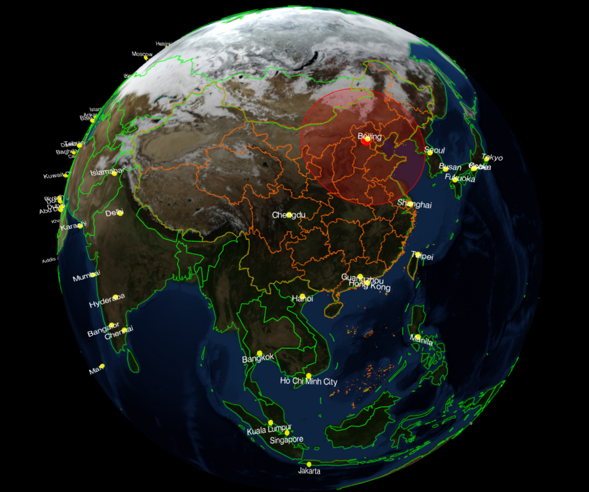

# 地球半径查看工具

一个基于地图的可视化工具，选择世界地图上的任意地点并模拟指定半径的覆盖范围。

## 功能概述

- **地图交互操作**：双击地图任意位置即可设定中心点。
- **参数控制面板**（页面右上角）：
  - 设置**半径**（单位：公里）
  - 精确调整**中心点的经纬度**
- 地图标注了全球主要的大型城市，以便进行地理定位和范围判断。



## 本地运行

运行环境要求：Git、Node.js 18+ 和现代浏览器。项目的本地构建及静态服务器不需要安装第三方 npm 依赖。

```bash
git clone git@github.com:weirongchuan/map_app.git
cd map_app
npm start
```

然后访问：

```text
http://localhost:8000
```

PowerShell：

```powershell
$env:PORT=8080
npm start
```

macOS / Linux：

```bash
PORT=8080 npm start
```
